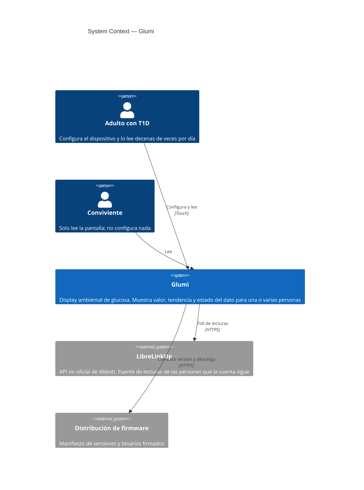
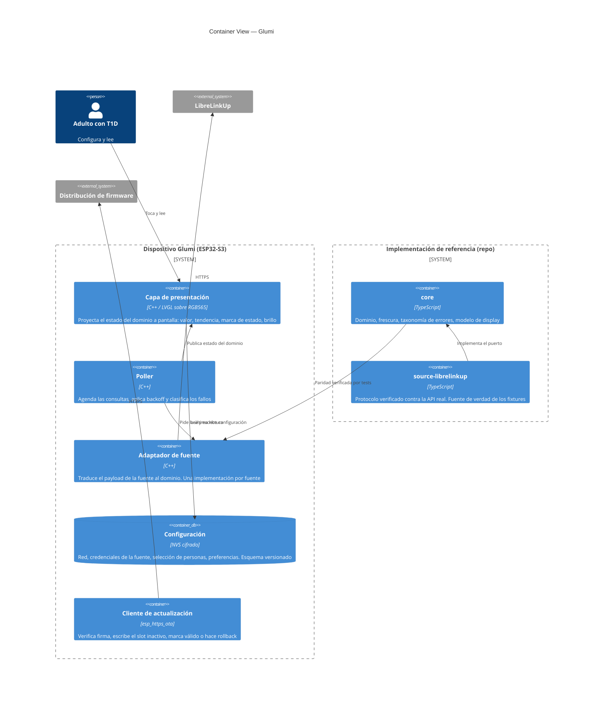

# Architecture Overview

El mapa a nivel sistema de Glumi. Define qué es el sistema, cómo se relacionan sus partes, con qué se integra y qué decisiones estructurales condicionan todo lo que viene después.

La forma general del sistema se explica en una frase: **Glumi es un dispositivo autónomo sin servidor propio.** No hay cuenta de usuario, no hay backend de datos y ningún valor de glucosa pasa por infraestructura del proyecto. El dispositivo habla directo con la fuente de datos usando las credenciales que su dueño le cargó en la pantalla. La única infraestructura que el proyecto opera existe para una sola cosa: distribuir firmware firmado.

---

## System Context

| External System | Type | Data Flow | Purpose |
| --------------- | ---- | --------- | ------- |
| LibreLinkUp | API no oficial (sin contrato, sin SLA) | Inbound | Única fuente de lecturas hasta el lanzamiento. Devuelve todas las conexiones que la cuenta sigue en una sola llamada |
| Distribución de firmware | Hosting estático + manifiesto | Inbound | Actualización remota. Es la mitigación del modo de falla "la fuente cambió el protocolo y todas las unidades se rompen a la vez" |
| Nightscout | API documentada del propio usuario | Inbound | Diferido a post-lanzamiento, entregado por actualización remota. Un sitio es una persona, lo que obliga al modelo de credenciales por fuente |

Lo que **no** aparece en este diagrama es tan estructural como lo que aparece: no hay API propia, no hay base de datos de usuarios, no hay app móvil y no hay asociación `user ↔ device` en ningún lado.

---

## Container View

| Component | Technology | Responsibility | Communicates With |
| --------- | ---------- | -------------- | ----------------- |
| Capa de presentación | C++ sobre bus RGB565 | Proyectar estado a pantalla e interacción táctil. No decide nada del dominio | Configuración, poller |
| Poller | C++ | Cadencia, backoff, clasificación de fallos | Adaptador, presentación |
| Adaptador de fuente | C++ | Traducir el payload al dominio. No filtra hacia arriba nada específico del proveedor | Fuente externa |
| Configuración | NVS cifrado, esquema versionado | Persistir red, credenciales, selección y preferencias | Presentación, adaptador |
| Cliente de actualización | `esp_https_ota` | Verificar firma, escribir slot inactivo, rollback | Endpoint de firmware |
| `packages/core` | TypeScript | Dominio y reglas, sin conocer proveedores | — |
| `packages/source-librelinkup` | TypeScript | Protocolo verificado contra la API real | — |

### La decisión estructural que más cuesta

**Cada protocolo se escribe dos veces:** una en TypeScript, como implementación de referencia ejecutable y verificada contra la API real, y otra en C++ sobre el dispositivo. Un arnés de paridad mantiene las dos alineadas contra los mismos fixtures.

Eso compra una cosa concreta y cara de conseguir de otro modo: poder investigar, reproducir y regresionar el comportamiento de una API no oficial sin un ESP32 en la mano. Y cuesta otra: **agregar una fuente no es un adaptador, son dos**, más fixtures y más rutas de paridad. Es la razón principal por la que el número de fuentes se mantiene en una hasta el lanzamiento.

El puerto `GlucoseSource` no nombra a ningún proveedor: si un tipo del paquete de dominio deja entrever de qué API viene el dato, la abstracción ya se rompió.

---

## Data Architecture

No hay base de datos. No hay historial. El sistema retiene exactamente una lectura por persona seguida —la última— en memoria, y la descarta cuando llega la siguiente.

Esto no es una simplificación de MVP: es la consecuencia directa de dos decisiones de producto. El producto muestra y no interpreta, así que no necesita historia. Y no existe backend de datos, así que no hay dónde ponerla aunque la necesitara.

| Storage System | Type | What It Stores | Access Pattern |
| -------------- | ---- | -------------- | -------------- |
| NVS del dispositivo | Clave-valor cifrado en reposo | Red Wi-Fi, credenciales de la fuente, selección y orden de personas, preferencias, versión del esquema | Escritura rara (configuración), lectura al boot |
| Memoria volátil | — | Última lectura por persona y estado derivado | Escritura por ciclo de poll, lectura por frame |

Sobre el dato mostrado rige una regla que ordena todo aguas abajo: **no se deriva ningún valor nuevo.** Todo lo que aparece en pantalla viene del payload de la fuente o del reloj. Es lo que descarta delta y countdown, y lo que evita tener que inventar reglas de frescura para valores calculados.

---

## Security Architecture

No hay autenticación de usuario porque no hay usuarios: quien tiene acceso físico al dispositivo tiene acceso a su configuración. Es la postura correcta para un objeto doméstico sin cuenta, y hace que el modelo de amenazas sea chico y explícito.

**Fronteras de confianza.** Son dos, y ninguna involucra infraestructura del proyecto manejando datos de salud:

1. **Dispositivo ↔ fuente de datos.** Credenciales del propio usuario, guardadas cifradas en reposo en NVS, usadas solo contra el host de la fuente sobre TLS. No se registran en logs: la taxonomía de errores se diseñó con esa restricción adentro, y ningún miembro de `SourceError` lleva credenciales, tokens ni cuerpos crudos.
2. **Dispositivo ↔ endpoint de firmware.** Es la superficie más sensible del sistema, porque una imagen arbitraria en un dispositivo donde alguien mira su glucosa es el peor resultado posible. Se defiende con **firma de imágenes**: la clave pública viaja dentro del binario flasheado y el dispositivo rechaza cualquier imagen que no verifique. La clave privada es un activo de largo plazo — perderla deja a la flota sin poder actualizarse nunca más; filtrarla deja a la flota sin poder confiar en una actualización nunca más.

**Entrada de credenciales en pantalla.** La contraseña de Wi-Fi se muestra en claro mientras se tipea, con opción de ocultarla. Es una concesión deliberada: sin gestor de contraseñas ni autocompletado, el riesgo de tipear a ciegas una cadena del sticker del router supera al de un mirón en la propia casa.

**Cumplimiento.** El producto se plantea como visualización secundaria no médica, con el CGM del fabricante como referencia terapéutica. La clasificación ANMAT no fue evaluada y es bloqueante para vender, no para uso personal ni para unidades entregadas sin cobrar. ⚠️

---

## Infrastructure Overview

La infraestructura del proyecto es un hosting estático con un manifiesto de versiones y binarios firmados. No hay cómputo, no hay base de datos y no hay estado de usuario.

Lo que la hace no trivial no es su tamaño sino su **permanencia**: cada unidad entregada o vendida consulta ese endpoint, y tiene que seguir existiendo más allá del interés del fundador en el proyecto. Una unidad que consulta un endpoint muerto es una unidad que eventualmente se rompe sin arreglo. Es el primer compromiso operativo permanente que toma Glumi, y la razón por la que se elige hosting estático barato y portable antes que cualquier cosa con runtime.

Del lado del dispositivo, el equivalente a "entornos" son los **canales de firmware**, y la seguridad operativa la da el bootloader: la imagen nueva se marca válida o el bootloader vuelve solo a la anterior. Sin portal web y sin app, esa es la única red de contención que tiene el usuario — junto al reset de fábrica alcanzable desde el touch.

| Environment | Purpose | Infrastructure | Access |
| ----------- | ------- | -------------- | ------ |
| Desarrollo | Implementación de referencia en TypeScript, contra fixtures y fuente falsa | Local | Fundador |
| Dispositivo de desarrollo | Firmware flasheado por USB, sin pasar por el canal de actualización | Hardware sobre el escritorio | Fundador |
| Canal estable | Lo que reciben las unidades entregadas y vendidas | Hosting estático + manifiesto | Público, solo lectura |

---

## Open Questions

| Question | Context | Owner | Target Date | Status | Resolution |
| -------- | ------- | ----- | ----------- | ------ | ---------- |
| ¿Quién custodia la clave privada de firma y qué pasa si el proyecto se detiene? | Es el activo más sensible del sistema y no tiene plan de sucesión | Matias Salzman | Antes de la primera unidad entregada | Open | |
| ¿La actualización se dispara sola o la aprueba el usuario? | Silenciosa es más calma; silenciosa en un objeto ligado al manejo de diabetes es una postura de riesgo que hay que elegir a propósito | Matias Salzman | Antes de implementar el cliente OTA | Open | |
| ¿Cómo se garantiza la permanencia del endpoint de firmware? | Tiene que sobrevivir al interés del fundador en el proyecto | Matias Salzman | Antes de la primera unidad vendida | Open | |
| ¿Cómo se representa el estado de fuente con varias personas? | Con una sola cuenta el estado es compartido; con Nightscout pasa a ser por persona. La proyección a pantalla tiene que seguir siendo total y verificable | Matias Salzman | Antes de integrar la segunda fuente | Open | |
| ¿Las credenciales en NVS se protegen con flash encryption del ESP32-S3 o con cifrado a nivel aplicación? | Define si hace falta quemar eFuses en producción, lo que es irreversible por unidad | Matias Salzman | Antes de P3 | Open | |
